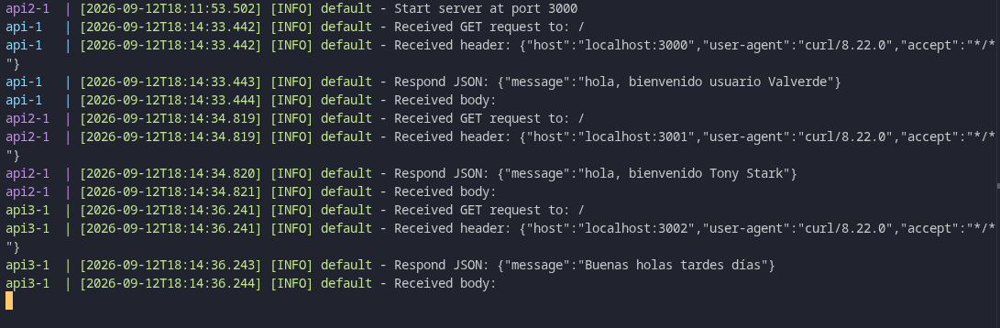
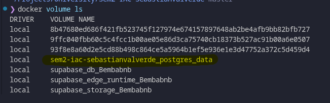
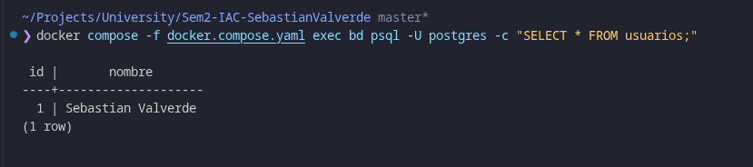

# Lab02 
### Sebastian Valverde Cedron - 000291195

## Introduccion
Primero preparamos el entorno básico creando el .env y las variables de entorno necesarias para la base de datos y para el mensaje de la api. También tenemos los archivos dockerfile y docker-compose.yaml. con la configuración mínima necesaria para empezar a testear el uso de docker con un levantamiento de prueba.

## instruccion

para inicializar el contenedor base podemos usar:
```bash
docker compose -f docker.compose.yaml up 
```
donde -f le dice a docker compose que use el archivo docker.compose.yaml para configurar los servicios. 

salida del primer docker compose de prueba:

```bash
~/Projects/University/Sem2-IAC-SebastianValverde master*
❯ docker compose -f docker.compose.yaml up
[+] up 3/3
 ✔ Network sem2-iac-sebastianvalverde_default Created                                                                              0.0s
 ✔ Container sem2-iac-sebastianvalverde-bd-1  Created                                                                              0.1s
 ✔ Container sem2-iac-sebastianvalverde-api-1 Created                                                                              0.1s
Attaching to api-1, bd-1
bd-1   | The files belonging to this database system will be owned by user "postgres".

api-1  | > sem2-iac-sebastianvalverde@1.0.0 start /opt
api-1  | > node src/api/server.js
bd-1   | This user must also own the server process.

api-1  | 
bd-1   | 
bd-1   | The database cluster will be initialized with locale "en_US.utf8".

bd-1   | The default database encoding has accordingly been set to "UTF8".
bd-1   | The default text search configuration will be set to "english".
bd-1   | 
bd-1   | Data page checksums are enabled.
bd-1   | 
bd-1   | fixing permissions on existing directory /var/lib/postgresql/18/docker ... ok
bd-1   | creating subdirectories ... ok
bd-1   | selecting dynamic shared memory implementation ... posix
bd-1   | selecting default "max_connections" ... 100
bd-1   | selecting default "shared_buffers" ... 128MB
bd-1   | selecting default time zone ... Etc/UTC
bd-1   | creating configuration files ... ok
api-1  | [2026-09-12T17:20:36.985] [INFO] default - Start server at port 3000
bd-1   | running bootstrap script ... ok
bd-1   | performing post-bootstrap initialization ... ok
bd-1   | syncing data to disk ... ok
bd-1   | 
bd-1   | 
bd-1   | Success. You can now start the database server using:
bd-1   | 
bd-1   |     pg_ctl -D /var/lib/postgresql/18/docker -l logfile start
bd-1   | 
bd-1   | initdb: warning: enabling "trust" authentication for local connections
bd-1   | initdb: hint: You can change this by editing pg_hba.conf or using the option -A, or --auth-local and --auth-host, the next time you run initdb.
bd-1   | waiting for server to start....2026-09-12 17:20:37.318 UTC [53] LOG:  starting PostgreSQL 18.6 (Debian 18.6-1.pgdg13+2) on x86_64-pc-linux-gnu, compiled by gcc (Debian 14.2.0-19) 14.2.0, 64-bit
bd-1   | 2026-09-12 17:20:37.319 UTC [53] LOG:  listening on Unix socket "/var/run/postgresql/.s.PGSQL.5432"
bd-1   | 2026-09-12 17:20:37.322 UTC [59] LOG:  database system was shut down at 2026-09-12 17:20:37 UTC
bd-1   | 2026-09-12 17:20:37.323 UTC [53] LOG:  database system is ready to accept connections
bd-1   |  done
bd-1   | server started
bd-1   | 
bd-1   | /usr/local/bin/docker-entrypoint.sh: ignoring /docker-entrypoint-initdb.d/*
bd-1   | 
bd-1   | 2026-09-12 17:20:37.429 UTC [53] LOG:  received fast shutdown request
bd-1   | waiting for server to shut down....2026-09-12 17:20:37.431 UTC [53] LOG:  aborting any active transactions
bd-1   | 2026-09-12 17:20:37.432 UTC [53] LOG:  background worker "logical replication launcher" (PID 62) exited with exit code 1
bd-1   | 2026-09-12 17:20:37.432 UTC [57] LOG:  shutting down
bd-1   | 2026-09-12 17:20:37.433 UTC [57] LOG:  checkpoint starting: shutdown immediate
bd-1   | 2026-09-12 17:20:37.438 UTC [57] LOG:  checkpoint complete: wrote 0 buffers (0.0%), wrote 3 SLRU buffers; 0 WAL file(s) added, 0 removed, 0 recycled; write=0.001 s, sync=0.001 s, total=0.006 s; sync files=2, longest=0.001 s, average=0.001 s; distance=0 kB, estimate=0 kB; lsn=0/1761918, redo lsn=0/1761918
bd-1   | 2026-09-12 17:20:37.446 UTC [53] LOG:  database system is shut down
bd-1   |  done
bd-1   | server stopped
bd-1   | 
bd-1   | PostgreSQL init process complete; ready for start up.
bd-1   | 
bd-1   | 2026-09-12 17:20:37.546 UTC [1] LOG:  starting PostgreSQL 18.6 (Debian 18.6-1.pgdg13+2) on x86_64-pc-linux-gnu, compiled by gcc (Debian 14.2.0-19) 14.2.0, 64-bit
bd-1   | 2026-09-12 17:20:37.546 UTC [1] LOG:  listening on IPv4 address "0.0.0.0", port 5432
bd-1   | 2026-09-12 17:20:37.546 UTC [1] LOG:  listening on IPv6 address "::", port 5432
bd-1   | 2026-09-12 17:20:37.547 UTC [1] LOG:  listening on Unix socket "/var/run/postgresql/.s.PGSQL.5432"
bd-1   | 2026-09-12 17:20:37.549 UTC [73] LOG:  database system was shut down at 2026-09-12 17:20:37 UTC
bd-1   | 2026-09-12 17:20:37.551 UTC [1] LOG:  database system is ready to accept connections
```

### commit: 

```
build(docker):agregar archivos base y variables de entorno como configuración inicial
```

Una vez se verifica el correcto funcionamiento de docker y una bd, se puede proceder a crear la arquitectura de múltiples contenedores que se encargaran de levantar la api 3 veces + el contenedor de la bd.

docker.compose.yaml
```
services:
  api:
    build: .
    ports:
      - "3000:3000"
  api2:
    build: .
    ports:
      - "3001:3000"
  api3:
    build: .
    ports:
      - "3002:3000"

  bd:
    image: 'postgres'
    environment:
      - 'POSTGRES_PASSWORD=${BD_PASSWD}'
```

resultado de logs en docker de 3 llamados: 

```
❯ docker compose -f docker.compose.yaml logs

api3-1  | 
api3-1  | > sem2-iac-sebastianvalverde@1.0.0 start /opt
api2-1  | 
api3-1  | > node src/api/server.js
api3-1  | 
api3-1  | [2026-09-12T17:45:00.895] [INFO] default - Start server at port 3000
api3-1  | [2026-09-12T17:48:15.078] [INFO] default - Received GET request to: /
api3-1  | [2026-09-12T17:48:15.078] [INFO] default - Received header: {"host":"localhost:3002","user-agent":"curl/8.22.0","accept":"*/*"}
api3-1  | [2026-09-12T17:48:15.079] [INFO] default - Respond JSON: {"message":"hello world!"}
api3-1  | [2026-09-12T17:48:15.079] [INFO] default - Received body: 
api2-1  | > sem2-iac-sebastianvalverde@1.0.0 start /opt
api2-1  | > node src/api/server.js
api2-1  | 
api2-1  | [2026-09-12T17:45:00.733] [INFO] default - Start server at port 3000
api2-1  | [2026-09-12T17:48:13.766] [INFO] default - Received GET request to: /
api2-1  | [2026-09-12T17:48:13.766] [INFO] default - Received header: {"host":"localhost:3001","user-agent":"curl/8.22.0","accept":"*/*"}
api2-1  | [2026-09-12T17:48:13.766] [INFO] default - Respond JSON: {"message":"hello world!"}
api2-1  | [2026-09-12T17:48:13.767] [INFO] default - Received body: 
bd-1    | The files belonging to this database system will be owned by user "postgres".
bd-1    | This user must also own the server process.
bd-1    | 
bd-1    | The database cluster will be initialized with locale "en_US.utf8".
bd-1    | The default database encoding has accordingly been set to "UTF8".
bd-1    | The default text search configuration will be set to "english".
bd-1    | 
bd-1    | Data page checksums are enabled.
bd-1    | 
bd-1    | fixing permissions on existing directory /var/lib/postgresql/18/docker ... ok
bd-1    | creating subdirectories ... ok
bd-1    | selecting dynamic shared memory implementation ... posix
bd-1    | selecting default "max_connections" ... 100
bd-1    | selecting default "shared_buffers" ... 128MB
bd-1    | selecting default time zone ... Etc/UTC
bd-1    | creating configuration files ... ok
api-1   | 
api-1   | > sem2-iac-sebastianvalverde@1.0.0 start /opt
api-1   | > node src/api/server.js
api-1   | 
api-1   | [2026-09-12T17:20:36.985] [INFO] default - Start server at port 3000
api-1   | [2026-09-12T17:48:09.239] [INFO] default - Received GET request to: /
bd-1    | running bootstrap script ... ok
bd-1    | performing post-bootstrap initialization ... ok
bd-1    | initdb: warning: enabling "trust" authentication for local connections
bd-1    | initdb: hint: You can change this by editing pg_hba.conf or using the option -A, or --auth-local and --auth-host, the next time you run initdb.
bd-1    | syncing data to disk ... ok
bd-1    | 
bd-1    | 
bd-1    | Success. You can now start the database server using:
bd-1    | 
bd-1    |     pg_ctl -D /var/lib/postgresql/18/docker -l logfile start
bd-1    | 
bd-1    | waiting for server to start....2026-09-12 17:20:37.318 UTC [53] LOG:  starting PostgreSQL 18.6 (Debian 18.6-1.pgdg13+2) on x86_64-pc-linux-gnu, compiled by gcc (Debian 14.2.0-19) 14.2.0, 64-bit
api-1   | [2026-09-12T17:48:09.239] [INFO] default - Received header: {"host":"localhost:3000","user-agent":"curl/8.22.0","accept":"*/*"}
api-1   | [2026-09-12T17:48:09.240] [INFO] default - Respond JSON: {"message":"hello world!"}
api-1   | [2026-09-12T17:48:09.241] [INFO] default - Received body: 
bd-1    | 2026-09-12 17:20:37.319 UTC [53] LOG:  listening on Unix socket "/var/run/postgresql/.s.PGSQL.5432"
bd-1    | 2026-09-12 17:20:37.322 UTC [59] LOG:  database system was shut down at 2026-09-12 17:20:37 UTC
bd-1    | 2026-09-12 17:20:37.323 UTC [53] LOG:  database system is ready to accept connections
bd-1    |  done
bd-1    | server started
bd-1    | 
bd-1    | /usr/local/bin/docker-entrypoint.sh: ignoring /docker-entrypoint-initdb.d/*
bd-1    | 
bd-1    | 2026-09-12 17:20:37.429 UTC [53] LOG:  received fast shutdown request
bd-1    | waiting for server to shut down....2026-09-12 17:20:37.431 UTC [53] LOG:  aborting any active transactions
bd-1    | 2026-09-12 17:20:37.432 UTC [53] LOG:  background worker "logical replication launcher" (PID 62) exited with exit code 1
bd-1    | 2026-09-12 17:20:37.432 UTC [57] LOG:  shutting down
bd-1    | 2026-09-12 17:20:37.433 UTC [57] LOG:  checkpoint starting: shutdown immediate
bd-1    | 2026-09-12 17:20:37.438 UTC [57] LOG:  checkpoint complete: wrote 0 buffers (0.0%), wrote 3 SLRU buffers; 0 WAL file(s) added, 0 removed, 0 recycled; write=0.001 s, sync=0.001 s, total=0.006 s; sync files=2, longest=0.001 s, average=0.001 s; distance=0 kB, estimate=0 kB; lsn=0/1761918, redo lsn=0/1761918
bd-1    | 2026-09-12 17:20:37.446 UTC [53] LOG:  database system is shut down
bd-1    |  done
bd-1    | server stopped
bd-1    | 
bd-1    | PostgreSQL init process complete; ready for start up.
bd-1    | 
bd-1    | 2026-09-12 17:20:37.546 UTC [1] LOG:  starting PostgreSQL 18.6 (Debian 18.6-1.pgdg13+2) on x86_64-pc-linux-gnu, compiled by gcc (Debian 14.2.0-19) 14.2.0, 64-bit
bd-1    | 2026-09-12 17:20:37.546 UTC [1] LOG:  listening on IPv4 address "0.0.0.0", port 5432
bd-1    | 2026-09-12 17:20:37.546 UTC [1] LOG:  listening on IPv6 address "::", port 5432
bd-1    | 2026-09-12 17:20:37.547 UTC [1] LOG:  listening on Unix socket "/var/run/postgresql/.s.PGSQL.5432"
bd-1    | 2026-09-12 17:20:37.549 UTC [73] LOG:  database system was shut down at 2026-09-12 17:20:37 UTC
bd-1    | 2026-09-12 17:20:37.551 UTC [1] LOG:  database system is ready to accept connections
bd-1    | 2026-09-12 17:25:37.604 UTC [71] LOG:  checkpoint starting: time
bd-1    | 2026-09-12 17:25:41.840 UTC [71] LOG:  checkpoint complete: wrote 42 buffers (0.3%), wrote 3 SLRU buffers; 0 WAL file(s) added, 0 removed, 0 recycled; write=4.209 s, sync=0.006 s, total=4.236 s; sync files=11, longest=0.002 s, average=0.001 s; distance=325 kB, estimate=325 kB; lsn=0/17B3160, redo lsn=0/17B3108
```

Para mayor ilustración se hizo un fix pequeño donde se manda un mensaje personalizado a cada api usando el .env con las variables MESSAGE1,MESSAGE2,MESSAGE3.



## Redes y volumenes


## Volumenes en la bd

Se hizo un añadido en la configuración del servicio de postgre dentro del docker.compose.yaml para indicar la ubicación del volumen de la bd.


se vuelve a levantar el entorno con el nuevo build usando

```bash
docker compose -f docker.compose.yaml up --build
```

y se verifica que los volumnes se han creado usando 

```bash
docker volume ls
```


y para una salida más detallada se emplea

```bash
docker volume inspect sem2-iac-sebastianvalverde_postgres_data
```

y se obtiene la siguiente salida


para hacer la prueba más interesante se creó una base de datos dentro del contenedor de postgres y se le insertó un usuario a nombre de "Sebastian Valverde".

```bash
# Crear tabla de prueba
docker compose -f docker.compose.yaml exec bd psql -U postgres -c "CREATE TABLE usuarios (id SERIAL PRIMARY KEY, nombre VARCHAR(50));"

# Insertar un registro
docker compose -f docker.compose.yaml exec bd psql -U postgres -c "INSERT INTO usuarios (nombre) VALUES ('Sebastian Valverde');"

```



Para comprobar la persistencia debemos los contenedores existentes y volver a levantar los mismos.

```bash
# Detener los contenedores
docker compose -f docker.compose.yaml down

# Verificar inexistencia de los contenedores
docker compose -f docker.compose.yaml ps -a

# Levantamos los contenedores
docker compose -f docker.compose.yaml up -d
```


