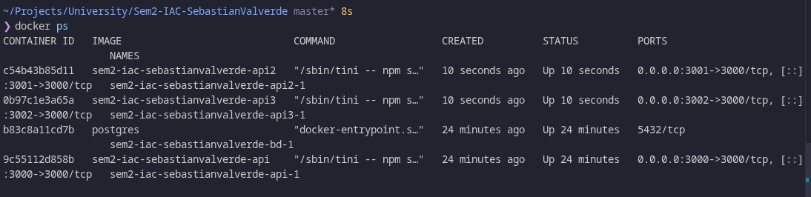
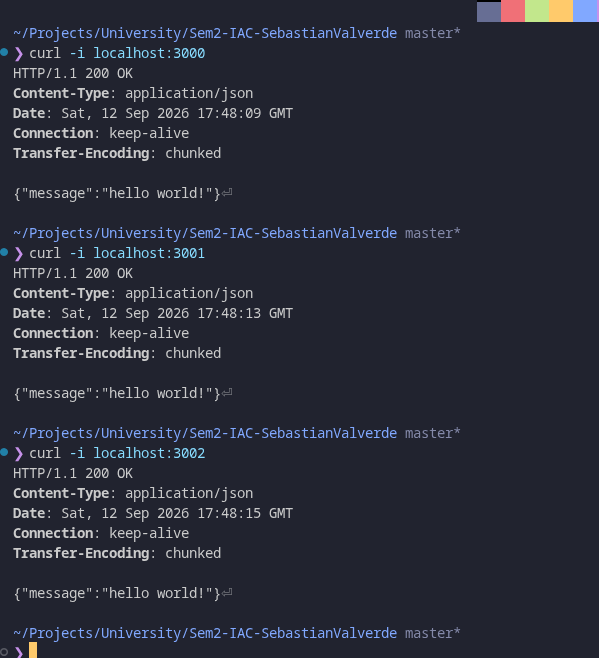
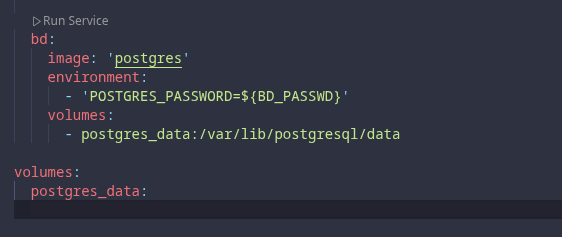
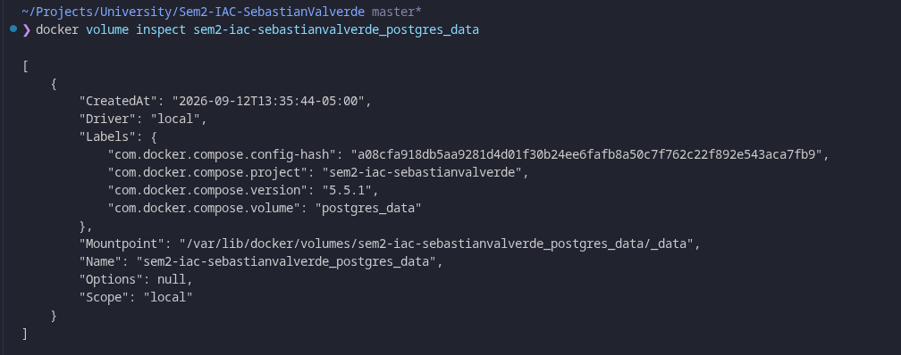
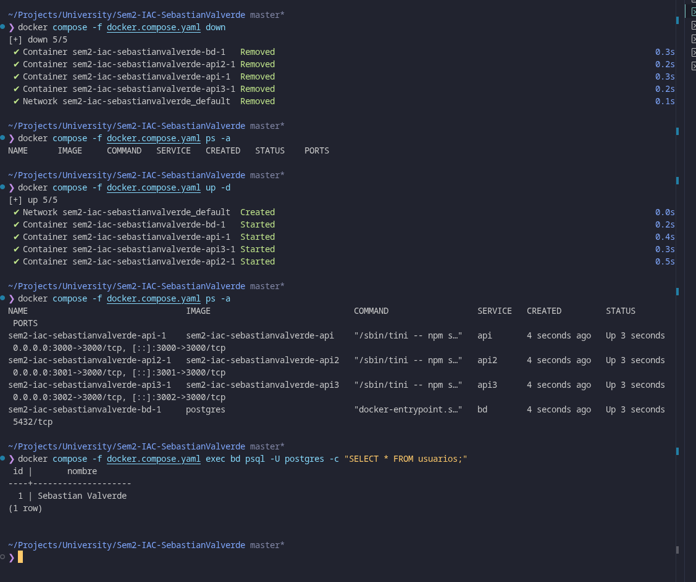

# Lab02 
### Sebastian Valverde Cedron - 000291195

## Introduccion
Primero preparamos el entorno básico creando el .env y las variables de entorno necesarias para la base de datos y para el mensaje de la api. También tenemos los archivos dockerfile y docker-compose.yaml. con la configuración mínima necesaria para empezar a testear el uso de docker con un levantamiento de prueba.

## instruccion

para inicializar el contenedor base podemos usar:
```bash
docker compose -f docker.compose.yaml up 
```
donde -f le dice a docker compose que use el archivo docker.compose.yaml para configurar los servicios. 

salida del primer docker compose de prueba:



### commit: 

```
build(docker):agregar archivos base y variables de entorno como configuración inicial
```

Una vez se verifica el correcto funcionamiento de docker y una bd, se puede proceder a crear la arquitectura de múltiples contenedores que se encargaran de levantar la api 3 veces + el contenedor de la bd.

docker.compose.yaml
```
services:
  api:
    build: .
    ports:
      - "3000:3000"
  api2:
    build: .
    ports:
      - "3001:3000"
  api3:
    build: .
    ports:
      - "3002:3000"

  bd:
    image: 'postgres'
    environment:
      - 'POSTGRES_PASSWORD=${BD_PASSWD}'
```

resultado de logs en docker de 3 llamados:



### commit: 

```
feat(compose): escalar api a 3 replicas con bd
```

Para mayor ilustración se hizo un fix pequeño donde se manda un mensaje personalizado a cada api usando el .env con las variables MESSAGE1,MESSAGE2,MESSAGE3.


### commit: 

```
fix(compose): asignar mensaje personalizado a cada api
```

## Redes y volumenes

tipos de redes:

tipos de volumen:

## Volumenes en la bd

Se hizo un añadido en la configuración del servicio de postgre dentro del docker.compose.yaml para indicar la ubicación del volumen de la bd.



se vuelve a levantar el entorno con el nuevo build usando

```bash
docker compose -f docker.compose.yaml up --build
```

y se verifica que los volumnes se han creado usando 

```bash
docker volume ls
```


y para una salida más detallada se emplea

```bash
docker volume inspect sem2-iac-sebastianvalverde_postgres_data
```

y se obtiene la siguiente salida



para hacer la prueba más interesante se creó una base de datos dentro del contenedor de postgres y se le insertó un usuario a nombre de "Sebastian Valverde".

```bash
# Crear tabla de prueba
docker compose -f docker.compose.yaml exec bd psql -U postgres -c "CREATE TABLE usuarios (id SERIAL PRIMARY KEY, nombre VARCHAR(50));"

# Insertar un registro
docker compose -f docker.compose.yaml exec bd psql -U postgres -c "INSERT INTO usuarios (nombre) VALUES ('Sebastian Valverde');"

```


Para comprobar la persistencia debemos los contenedores existentes y volver a levantar los mismos.

```bash
# Detener los contenedores
docker compose -f docker.compose.yaml down

# Verificar inexistencia de los contenedores
docker compose -f docker.compose.yaml ps -a

# Levantamos los contenedores
docker compose -f docker.compose.yaml up -d
```



### commit: 

```
feat(compose): agregar volumen persistente a la bd
```


